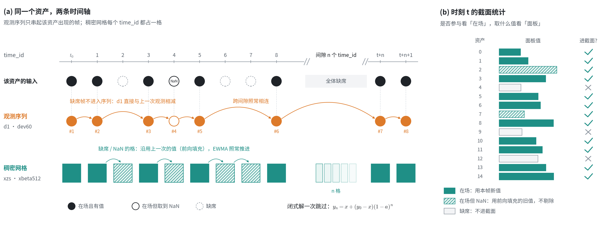
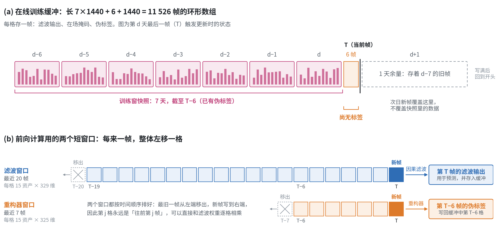
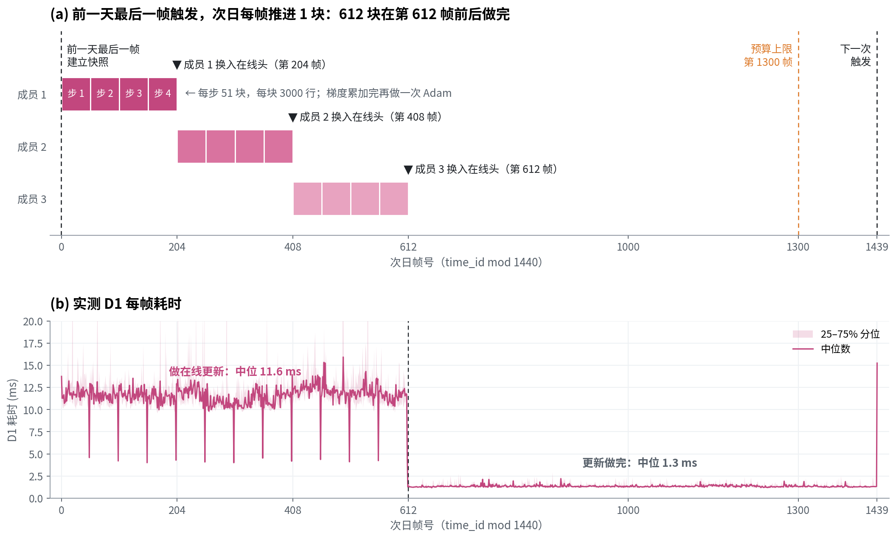

# 工程实现

> **摘要**　本报告讲三个核心工程实现细节。**一、GBDT 特征的流式构建**：派生特征分别沿两条时间轴逐帧递推，每帧的计算量不随历史变长而增加。**二、D1 的时间维状态**：前向计算用短窗口，在线训练用一个 7 天的环形缓冲，伪标签延迟 6 帧写回。**三、在线学习的分块**：日末的全批量更新切成小块，分摊到次日前 612 帧做完，结果与一次做完完全相同。

记每个time_id为一帧。

---

## 1　GBDT 特征的流式构建

离线训练时，派生特征是在整张表上一次算出来的。推理时只能看到当前这一帧，所以要改成逐帧递推：只保存少量状态，每来一帧更新一次，并且结果与离线计算一致。

### 1.1　两条时间轴

两类派生特征对"上一步"的定义不同，必须分开维护状态：

- **时序特征**（`d1`、`dev60`）沿**该资产自己的观测序列**推进。资产缺席的帧不进入序列，差分直接和它上一次出现时的值相减。
- **截面特征**（`xzs`、`xbeta512`）沿**稠密的 `time_id` 网格**推进。每个 `time_id` 都占一格，资产缺席时沿用它上一次的值。

### 1.2　观测序列：每个资产一个环形缓冲

每个资产保存两样东西：上一次的观测值，用来算差分；一个长 60 的环形缓冲，用来算滚动均值。资产出现一次，就写入一次，并覆盖最旧的那一格。

源数据中的缺失要按"跳过"处理，不能让它把均值污染成 NaN。所以缓冲里同时记录每一格是否有效。滚动均值只对有效格取平均；有效格不足 10 个时输出缺失。

### 1.3　稠密网格：前向填充面板 + EWMA 递推 beta

为每个资产维护一张"当前值"面板。资产出现且取值有效时更新，否则保留旧值。

- **截面 z-score**：只用当期在场资产的面板值计算均值和标准差。注意两件事分开处理：一个资产要不要参与统计，看它是否在场；参与时用什么值，看面板。所以在场但取到 NaN 的资产仍然参与统计，用的是它的旧值（图 (b)）。
- **滚动 beta**：beta 是资产值对截面均值 $\mu$ 的协方差除以 $\mu$ 的方差，可以拆成 4 个一阶矩的 EWMA：

  $$
  \beta=\frac{E[x\mu]-E[x]\,E[\mu]}{E[\mu^2]-E[\mu]^2}
  $$

  每帧只更新这 4 个均值，不用保存半衰期 512 的长窗口。

### 1.4　间隙：闭式解一次跳过

`time_id` 偶尔会跳空，公开 test 中出现过 1445 帧的间隙。离线时，跳过的格子被当作"全体缺席"，EWMA 照样逐格推进，所以在线也必须补上这些步数。

全体缺席时，面板值不变，截面均值为 0，EWMA 的输入是常数。一阶递推在常数输入下有闭式解：

$$
y_n = x + (y_0-x)(1-a)^n
$$

因此无论间隙多长，都只需算一次，结果与逐格推进相同。

---

## 2　D1 的时间维状态

D1 每一帧都要用到两类历史：前向计算需要最近 20 帧（因果滤波）和最近 7 帧（伪标签重构）；在线训练需要最近 7 天的样本。这两类历史都保存在定长数组里，每帧滚动一次。

### 2.1　两类历史，两种缓冲

- **前向计算用短窗口**：滤波窗口长 20 帧，重构器窗口长 7 帧。每来一帧，整体左移一格，新帧写到末尾。
- **在线训练用环形缓冲**：每格存一帧的滤波输出、在场掩码和伪标签。长度为 7 天训练窗 + 6 帧标签延迟 + 1 天余量，共 11 526 帧。写指针每帧前进一格，写满后回到开头。

### 2.2　缓存滤波输出，而不是原始特征

在线学习只更新 MLP 头，滤波器和资产嵌入都是冻结的。所以每一帧的滤波输出在算出的那一刻就是最终值，可以直接缓存。日末训练时，只需对缓存的结果做 MLP 头的前向和反向，不用把 7 天的数据重新滤波一遍。

### 2.3　伪标签延迟 6 帧写回

重构第 $t$ 帧的标签，要用到第 $t$ 到 $t+6$ 帧的特征。所以第 $T$ 帧到来时，只能给第 $T-6$ 帧补上伪标签，写回它在缓冲中原来的那一格。因此缓冲里最新的 6 帧总是没有标签，日末训练的窗口截至 $T-6$。

### 2.4　缺席帧照常入队

遇到 `time_id` 间隙时，每个跳过的帧都要按"全体缺席"推入缓冲，否则缓冲中"第几帧在哪一格"的对应关系会错位。

这些帧的训练权重为 0，它们的滤波输出不会影响任何结果，所以补帧时跳过滤波，直接写零。这样长间隙也不会在一帧内引发上千次滤波。写零而不是保留旧值，是因为旧值可能让输出溢出成 inf，而 inf × 0 = NaN 会污染整份梯度。

---

## 3　在线学习的分块

每天最后一帧触发一次在线更新：3 个成员各自用最近 7 天约 15 万行样本，做 4 步全批量 Adam。这些计算在一帧的时限内做不完，所以要拆开，分摊到之后的帧里做。

### 3.1　日末快照，次日分摊

日末那一帧只做一件事：建立快照，记下训练窗覆盖哪些帧、每个样本的权重和伪标签。真正的计算从次日开始：每帧做一块（200 time_id× 15 个资产 = 3000 行），3 个成员依次推进。

快照引用的是日末那一刻环形缓冲里的内容。次日新写入的帧落在缓冲预留的 1 天余量里，不会覆盖快照里的数据，这就是缓冲多留 1 天的原因。

### 3.2　分块累加 = 全批量梯度

每一块的损失都除以**整个训练窗**的权重总和，而不是这一块自己的权重和：

$$
g=\sum_{\text{块 } c}\nabla_\theta\frac{\sum_{i\in c}w_i(y_i-\hat y_i)^2}{\sum_{\text{全窗}}w}
$$

所以把一步内的所有块累加起来，得到的就是全批量梯度。等这一步的块全部算完，才执行一次 Adam 更新。分块只是把计算拆到了多帧里，**不是 mini-batch 近似**，结果与一次做完完全相同。

### 3.3　成员整体换入

预测时用的在线头，只在一个成员的 4 步全部做完后才更新一次。所以任何一帧用到的在线头，要么是更新前的，要么是完整更新后的，不会出现更新到一半的参数。

代价是有一段生效延迟：3 个成员的新头依次在次日第 204、408、612 帧换上。事实上预算还很充足，可以进一步减少延迟

### 3.4　计算预算

每个成员每步 51 块，总共 51 × 4 步 × 3 个成员 = 612 块。按每帧 1 块计算，在次日第 612 帧完成，离下一次日末还有很大余量。

实测结果见图 (b)：次日前 612 帧，D1 每帧耗时中位数为 11.6 ms；更新完成后降到 1.3 ms。日末更新的计算量被均匀摊开，没有集中在某一帧。
