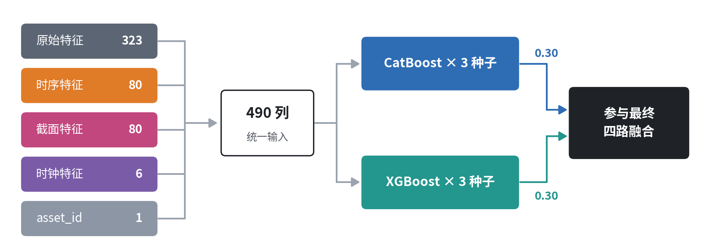
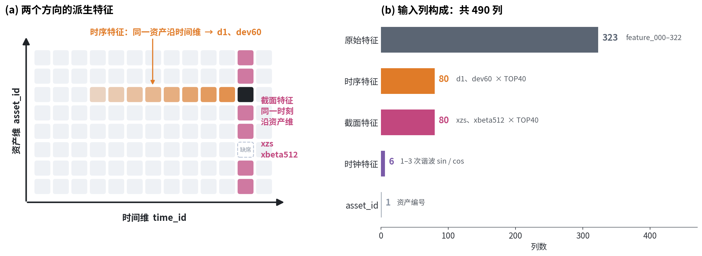
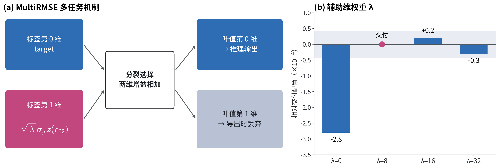

# GBDT 模型族：CatBoost 与 XGBoost

> **摘要**　GBDT 模型族包含 CatBoost 和 XGBoost 两个模型，在四路融合中合计占 0.60 的权重，是融合的主体。两个模型的输入相同，都是 490 列：323 列原始特征，加上在 40 根基特征上构造的 80 列时序特征和 80 列截面特征，再加 6 列时钟特征和 asset_id。CatBoost 另外用 MultiRMSE 把 `responder_02` 作为辅助标签参与分裂选择。调参的基本结论是：真正重要的超参主要是两个方面：1.学习率与轮数 2.树的规模与形状；交付配置的本地五折 cv 分数为 CatBoost 43.76、XGBoost 43.79，两者等权平均为 45.44。

分数单位均为 $10^{-4}$（加权 R²）。验证方式和种子噪声见本地验证系统构建部分。

---

## 1　总览

|          | CatBoost                          | XGBoost                                 |
| -------- | --------------------------------- | --------------------------------------- |
| 输入     | 490 列（同一套）                  | 490 列（同一套）                        |
| 树形     | 对称树，深 8                      | 按收益长叶，最多 512 叶                 |
| 监督     | **MultiRMSE：target + r02** | 单任务 target                           |
| 关键配置 | lr 0.03 × 500 轮，l2 100         | eta 0.015 × 320 轮，列采样 0.3，λ 100 |
| 融合权重 | 0.30                              | 0.30                                    |

两个模型都在全部 768 天上训练，样本按 `weight` 加权，各取 3 个种子做平均作为 1 路。

关键技术点有两个：

- **特征工程**（第 2 节）：在原始特征之外，从"时间"和"截面"两个方向补充信息。
- **多任务监督**（第 3.1 节）：catboost使用 responder 02 来共同约束分裂选择。

---

## 2　特征工程

### 2.1　基特征：TOP40

派生特征只在 40 根基特征上构造。选法是按**单变量相关强度**排序：在原始 323 列上，逐列计算与 target 的加权相关系数 |corr|，取最强的 40 根。尝试过使用更多数量的基特征，增益效果不显著。

### 2.2　时序特征（80 列）

沿**该资产自己的观测序列**计算，资产缺席的 `time_id` 不进入序列：

| 特征      | 定义                                            | 含义               |
| --------- | ----------------------------------------------- | ------------------ |
| `d1`    | $x_t - x_{t^-}$，$t^-$ 为该资产的上一次观测 | 最新一步的变化     |
| `dev60` | $x_t - \overline{x}_{\text{最近 60 次观测}}$  | 相对近期水平的偏离 |

### 2.3　截面特征（80 列）

在**同一 `time_id` 的在场资产之间**计算，记 $\mu_t, \sigma_t$ 为当期截面均值与标准差：

| 特征         | 定义                                                                                          | 含义                         |
| ------------ | --------------------------------------------------------------------------------------------- | ---------------------------- |
| `xzs`      | $(x_{i,t} - \mu_t)/\sigma_t$                                                                | 该资产在当期截面中的相对位置 |
| `xbeta512` | $\dfrac{\mathrm{Cov}_{\text{EWMA}}(x_i, \mu)}{\mathrm{Var}_{\text{EWMA}}(\mu)}$，半衰期 512 | 该资产对"市场因子"的暴露     |

### 2.4　时钟特征（6 列）

即 $\text{time\_id} \bmod 1440$ 的 1–3 次谐波，详见 time_id 报告。

### 2.5　特征消融

相对交付配置的五折均值变化（3 种子，括号内为变差的折数）：

| 改动           |                CatBoost |                 XGBoost |
| -------------- | ----------------------: | ----------------------: |
| 去掉时序 80 列 |            +0.08（2/5） | **−1.64（5/5）** |
| 去掉截面 80 列 | **−1.56（3/5）** | **−4.33（5/5）** |
| 去掉时钟 6 列  | **−3.28（5/5）** | **−3.07（5/5）** |
| 去掉 asset_id  |           −0.34（4/5） |            -0.42（4/5） |

---

## 3　CatBoost

### 3.1　MultiRMSE 多任务监督

**机制**：把标签扩成两维，

$$
Y = \big[\; y,\;\; \sqrt{\lambda}\,\sigma_y \cdot \mathrm{clip}(z(r_{02}), \pm 5) \;\big], \qquad \lambda = 8
$$

第二维是标准化后的 `responder_02`，简称r02，缩放到 $\sqrt{\lambda}$ 倍的 target 标准差，λ 控制它在损失中的分量。

MultiRMSE 的损失是两维平方误差之和。

- **分裂选择**：分裂增益按两维相加。一个切分只有同时有利于 target 和 r02，才会被选中。
- **叶值**：每一维独立求解，第 0 维的叶值只由 target 决定。
- **推理**：导出时只保留第 0 维叶值。推理路径与单任务模型完全相同，不需要 responder。
- **结论**：λ = 0（退化为单任务）−2.8，5/5 折为负；λ 取 8–32 结果一致。可见关键在于用不用辅助标签，具体用多大的权重是个宽平台，r02 与 target 相关、用它参与分裂选择可以视为一种正则化，防止过拟合，让树的结构更稳。

### 3.2　超参数与敏感性分析

| 类别     | 超参              | 交付值 | 重要性 | 结论                                                                                                                         |
| -------- | ----------------- | -----: | :----: | ---------------------------------------------------------------------------------------------------------------------------- |
| 步长     | `learning_rate` |   0.03 | ★★★ | 往大调明显变差（0.08 −1.5，0.12 −2.9）；往小调持平或略好（0.01 +0.7，需 2150 轮）                                          |
| 轮数     | `iterations`    |    500 | ★★★ | 须与学习率配套：最优轮数与学习率成反比，乘积约 12–21（0.01→2150，0.02→850，0.03→500，0.05→300，0.08→150，0.12→100）； |
| 监督     | 辅助维 λ         |      8 | ★★★ | λ=0 −2.8；8–32 为平台                                                                                                     |
| 树的规模 | `depth`         |      8 |  ★★  | 7–8 为平台；4 为 −2.2，10 为 −0.8，两头都差                                                                               |
| 正则     | `l2_leaf_reg`   |    100 |   平   | 10–1000 都在噪声内，3000 略差（−0.5）                                                                                      |
| 采样     | `subsample`     |    0.8 |   平   | 0.5–1.0 都在噪声内                                                                                                          |
| 分箱     | `border_count`  |    128 |   平   | 都在 ±0.6 以内                                                                                                              |

---

## 4　XGBoost

### 4.1　超参数与敏感性分析

| 类别     | 超参                                          |        交付值 |  重要性  | 结论                                                                                                                       |
| -------- | --------------------------------------------- | ------------: | :------: | -------------------------------------------------------------------------------------------------------------------------- |
| 步长     | `eta`                                       |         0.015 | ★★★★ | 往大调变差得很快（0.025 −2.3，0.04 −5.2，0.06 −6.9）；0.005 训 1140 轮 +2.1，5/5 折为正（还有进步空间没有挖掘，可惜了） |
| 轮数     | `num_boost_round`                           |           320 | ★★★★ | 须与 eta 配套：最优轮数与 eta 成反比，乘积约 4–6（0.005→1140，0.01→560，0.015→320，0.025→180，0.04→100，0.06→60）； |
| 树形     | `grow_policy`                               |     lossguide |   ★★   | 按深度生长全面不如按收益长叶（depthwise 深 6/8/10：−3.1/−1.2/−1.6）                                                     |
| 树的规模 | `max_leaves`                                |           512 |   ★★   | 256–512 为平台；64 为 −2.0，2048 为 −1.3                                                                                |
| 采样     | `colsample_bytree`                          |           0.3 |   ★★   | 0.2–0.3 为平台；不采样（1.0）−1.5，5/5 折为负                                                                            |
| 采样     | `subsample`                                 |           0.8 |    ★    | 不采样（1.0）−1.1，其余平                                                                                                 |
| 正则     | `alpha`（L1）                               |             0 |    ★    | 到 1000 才变差（−1.0），10–100 平                                                                                        |
| 正则     | `lambda`、`min_child_weight`、`max_bin` | 100 / 1 / 128 |    平    | 都在噪声内                                                                                                                 |

和 CatBoost 相比，XGBoost 对学习率更敏感，并且多出了两个有效的结构性选择：按收益长叶，以及较强的列采样。列采样 0.3 意味着每棵树只能看到约 150 列，这迫使模型分散地使用特征，也拉开了它和 CatBoost 的差异，强正则的同时降低了相关性。

---

## 5　What didn't work

| 方向       | 尝试                                                                      | 结果         |
| ---------- | ------------------------------------------------------------------------- | ------------ |
| 在线学习   | 仿照 MLP 的在线头，私榜期间用新数据更新树模型，对于树模型而言需要全量重训 | 资源上不可行 |
| 基特征数量 | 在更多基特征上构造派生特征                                                | 增益不显著   |
| 基特征选法 | 按树模型 gain 选 40 根等                                                  | 有害         |

- **树模型无法像 MLP 那样做在线学习**：MLP 的在线头只需在最近 7 天的数据上做几步梯度更新。树模型训练完后结构就固定了，要吸收新数据只能全量重训。但是在资源有限的评测环境中不可行。所以 GBDT 只能作为冻结模型参与融合，适应漂移交给 MLP 的在线头完成。
