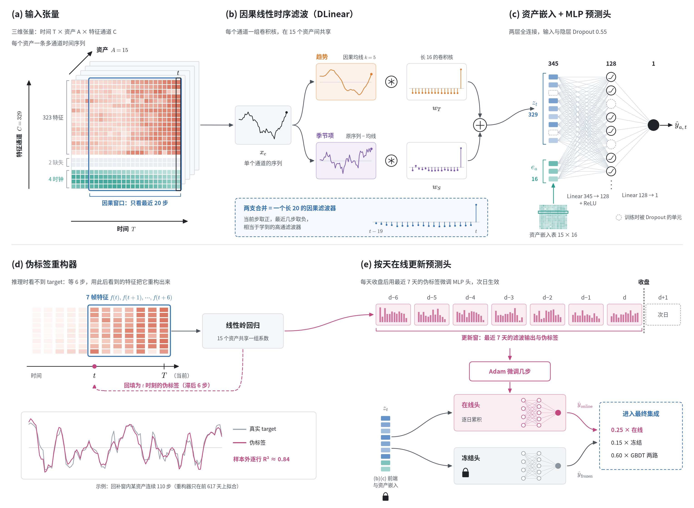
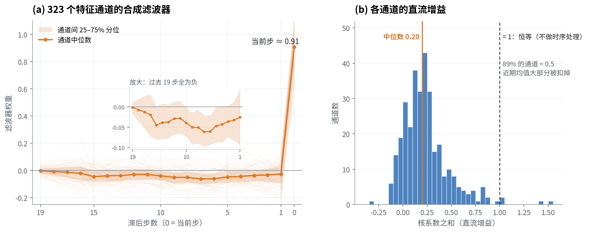
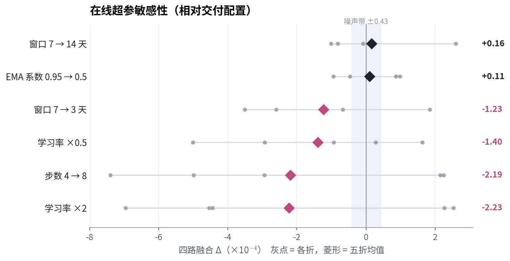
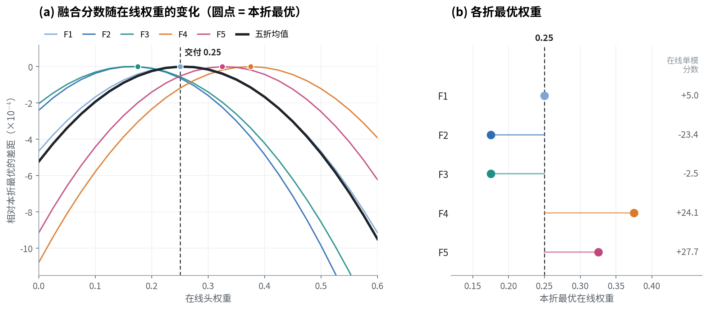

# MLP 模型族（D1）

> **摘要**　D1 是策略中的神经网络分支，结构很简单：每个特征通道过一个长 20 的因果线性滤波器，拼上资产嵌入，再接一个单隐层 MLP 头。它有两个核心设计。一是**线性时序滤波前端**：网络沿时间方向做一次逐通道的线性卷积。二是**在线学习**：推理时看不到 target，我用一个岭回归重构器从后 6 步的特征里把 target 重构出来作为伪标签，每天最后一帧用最近 7 天的伪标签微调 MLP 头。融合时，冻结头与在线头作为两个独立成员，分别占 0.15 与 0.25 的权重。本地cv五折上 D1 冻结头单模 37.65，在线头单模只有 6.19，但在线头给四路融合带来 +6.05，是 D1 价值的主要来源。

分数单位均为 $10^{-4}$（加权 R²），验证口径见本地验证系统构建部分。D1 是开发代号，由于方便沿用。

---

## 1　总览

整体流程：

1. **输入**（a）：把数据整理成 时间 × 资产 × 通道 的稠密网格，每个资产每一时刻 329 个特征通道。
2. **时序前端**（b）：每个通道用一个长 20 的因果卷积核沿时间滤波，15 个资产共享。
3. **预测头**（c）：滤波输出拼上 16 维资产嵌入，经单隐层 MLP 输出预测。
4. **在线学习**（d, e）：推理时用重构器给 6 步前的帧打伪标签；每天最后一帧用最近 7 天的伪标签微调 MLP 头，时序前端冻结。
5. **融合**（e）：冻结头与在线头分别作为一路进入四路融合。

---

## 2　输入与预处理

每个 (time_id, 资产) 一行 329 列：

| 列       | 数量 | 预处理                                                                                                                                           |
| -------- | ---: | ------------------------------------------------------------------------------------------------------------------------------------------------ |
| 原始特征 |  323 | 用 0630 训练集（前 617 天）的均值、标准差进行简单全局标准化，截断到 ±5，**缺失填 0**。                                                         |
| 缺失信息 |    2 | **1.缺失比例**：该行 323 个原始特征中缺失（null）的个数 ÷ 323，取值 0～1； **2.是否全缺失**：缺失比例等于 1 时为 1，否则为 0。 |
| 时钟特征 |    4 | $\text{time\_id} \bmod 1440$ 的 1、2 次谐波，详见 time_id 报告                                                                                 |

- 资产在某一时刻缺席时，整行按"全缺失"填充（原始特征全为 0，缺失比例 = 1，是否全缺失 = 1），保证每个资产都有一条等间隔的时间序列，滤波器可以直接在上面做卷积。
- 原始特征缺失填 0 之后，模型分不清"值恰好等于均值"和"没有数据"。这两列缺失信息就是为了把这一区别告诉模型。
- 标准化统计量拟合一次后冻结，推理时逐帧套用，不随数据更新。
- 没有任何人工派生特征。时间方向的信息全部交给前端去学；截面方向没有显式通过特征工程建模。

---

## 3　时序前端：一个长 20 的因果卷积核

### 3.1　结构

记特征通道 $c$ 的序列为 $x_c$，前端输出

$$
z_{c,t} = \sum_{j=0}^{19} w_{c,j}\, x_{c,\,t-j}
$$

- **因果**：只用当前及之前 19 步。
- **逐通道**：329 个通道各一个核，通道之间不混合，混合交给后面的 MLP。
- **资产共享**：15 个资产用同一组核。
- **初始化为单位脉冲**（$w_{c,0}=1$，其余为 0）：训练起点等价于"不做时序处理"的普通 MLP。

比赛提交策略中这个前端是按 DLinear 的方式参数化的：先用长 5 的因果滑动平均把序列拆成趋势和残差两支，两支各过一个长 16 的线性层再相加。但两支都是线性的，叠加后严格等价于一个长 16 + 5 − 1 = 20 的卷积核，推理包里也只存了合成后的核。在比赛之后我尝试继续简化概念，取消dinear形式的两路分解，效果保持一致，略有提升，但不显著，证明dlinear并没有带来实际的归纳偏置增益。

### 3.2　卷积核实际学到了什么

- 当前步权重约 0.89，过去 19 步全部为小的负权重，形态非常一致（a）。
- 绝大多数通道的系数之和在 0–0.5 之间，远低于 1（b）。也就是说，前端输出的主要是**当前值相对近期水平的偏离**，近期均值被大部分扣掉了。这相当于一个学出来的高通滤波器，与 GBDT 中人工构造的 `dev60`（相对近 60 次观测均值的偏离）思路一致，只是由网络为每个通道自己决定窗口形状。

---

## 4　MLP预测头：资产嵌入 + 单隐层 MLP

$$
\hat y_{a,t} = W_1\,\mathrm{ReLU}\big(W_0\,[\,z_{t};\ e_a\,] + b_0\big) + b_1
$$

- $e_a$ 是 16 维资产嵌入，让同一组滤波器和 MLP 能针对不同资产给出不同的映射，资产嵌入可学习。
- 隐层 128，**输入层与隐层都用 0.55 的 Dropout**。数据信噪比很低，强 Dropout 是这个头不过拟合的关键。
- 尽可能选择参数量少的结构，防止过拟合，提升在线更新速度。

---

## 5　训练设置（冻结模型）

| 项     | 设置                                                                |
| ------ | ------------------------------------------------------------------- |
| 数据   | 全部 768 天，无验证集、无早停                                       |
| 取批   | 每步随机取**一整天**（1440 帧 × 15 资产）作为一个 batch      |
| 损失   | 按`weight` 加权的 MSE                                             |
| 优化器 | AdamW，lr 5.7e-4，cosine 退火到 5%，weight decay 0.01，梯度裁剪 1.0 |
| 步数   | 24 000 步                                                           |
| SWA    | 从 25% 步数起，每 50 步取一次快照，最终权重为全部快照的平均         |

- **一天一个 batch**：尽量使得同一 batch 内各时刻共享同一段（一天）市场状态。
- **SWA 代替早停**：没有留验证集，交付的就是跑满步数的 SWA 平均。SWA 把后 75% 训练轨迹上的权重平均掉，降低了对"停在哪一步"的敏感度。

---

## 6　在线学习

私榜期间数据分布持续漂移，冻结模型会逐渐过时。但推理时拿不到 target，无法直接用真实标签更新。我的的做法分两步：先**重构伪标签**，再用伪标签**日末更新预测头**。

### 6.1　伪标签重构器

target 描述的是未来一段时间的变化，而这段"未来"会在之后几步的特征里逐渐体现出来。所以等 6 步之后，用 $f(t), f(t+1), \ldots, f(t+6)$ 就能把 $t$ 时刻的 target 较好地还原出来：

$$
\tilde y_{a,t} = \sum_{j=0}^{6} \beta_j^{\top} f_{a,\,t+j} + \gamma_a
$$

- 线性岭回归（λ = 10），7 帧 × 325 列 + 15 个资产截距，15 个资产共享系数。
- 只在前 617 天上拟合一次，之后冻结。在第 618–766 天验证，逐行 R² ≈ **0.84**，不随time_id增加表现下降，较为稳定可信，见总览图 (d) 。
- 推理时，第 $T$ 帧到来后给第 $T-6$ 帧打上伪标签，并截断到训练集 target 的取值范围内。

### 6.2　在线更新机制

在线阶段同时维护三份MLP预测头：

- **冻结头**：离线训练的结果，始终冻结，单独作为一路输出。
- **工作头**：真正被梯度更新的头，逐日累积。
- **在线头**：工作头的 EMA 平滑，用于预测，作为另一路输出。（事实上，EMA平滑这个机制很鸡肋，几乎没有影响，是vibe coding的遗留物，直接将工作头视为在线头更加简洁）

每天收盘（$p = 1439$）触发一次更新：

| 项       | 设置                                                             |
| -------- | ---------------------------------------------------------------- |
| 训练数据 | 最近 7 天、已有伪标签的帧（即截至$T-6$），7 天等权             |
| 目标     | 与离线训练相同的按 weight 加权 MSE；缺席的资产权重为 0           |
| 更新对象 | 只更新 MLP 头；滤波器和资产嵌入冻结                              |
| 优化     | 全批量 Adam 4 步，lr 5e-4，β = (0.95, 0.97)，每天新建优化器状态 |
| 平滑     | 在线头 ← 0.05 · 在线头 + 0.95 · 工作头                        |
| 生效     | 计算分摊到次日的前若干帧，完成后换入                             |

几个关键设计：

- **每天在线更新时采用全新的adam优化器状态**：Adam 的一阶、二阶矩和步数每天清零，不继承前一天的动量。
- **在线更新逐日累积**：工作头每天从前一天的状态继续更新。时间一长，在线头会和冻结头拉开距离。
- **只更新MLP头**：时序前端冻结，实验也表明时序前端在线更新有害。

### 6.3　在线超参敏感性

- 在线头单模分数只有 6.19，且各折差异极大（F2 −23.36，F5 +27.72）。单看它几乎不可用。
- 但它与其他三路的相关性低（与 GBDT 约 0.65，与冻结头 0.74），放进融合后带来 **+6.05**，5/5 折为正（+2.2 到 +9.8）。
- 超参敏感性：学习率加倍或减半、步数加倍、窗口缩短到 3 天，都使融合变差 1–2 以上；窗口 14 天、EMA 系数 0.5 与交付配置持平。交付配置处在一个比较窄的可用区间里，可见**更新的力度是最敏感的超参**。

---

## 7　融合：将冻结头与在线头视为两个不同的成员

D1 不在内部把两个头混成一路，而是把**冻结头**和**在线头**作为两个独立成员交给四路融合：

$$
\hat y = 0.30\,\text{Cat} + 0.30\,\text{XGB} + 0.15\,\text{D1}_{\text{冻结}} + 0.25\,\text{D1}_{\text{在线}}
$$

### 7.1　在线部分融合权重分析

固定 GBDT 两路与冻结头的比例（0.30 : 0.30 : 0.15），把在线头权重从 0 扫到 0.6，其余三路等比缩放，逐折找最优点：

- **各折最优权重分散**：分别为 0.25 / 0.175 / 0.175 / 0.375 / 0.325。最优权重和在线头单模表现一致：在线头单模为负的 F2、F3 偏小，单模较好的 F4、F5 偏大。这说明在线头在不同时期的可用程度差别很大，没有一个对每段时间都最优的权重。
- **五折均值曲线的峰在 0.25**，曲线在 0.2–0.3 之间很平（与峰值r2相差不到 -0.25），两侧到 0 或 0.5 时才明显下降。
- **留一折检验**：用其余四折选权重，得到的是 0.225 或 0.275，都落在 0.25 相邻，说明这个选择不是被某一折决定，较为稳健。

**为什么选 0.25**：未来哪一段时期在线头好用，事先无法知道，所以不追求单折最优，而选一个对各折都不太差的折中点。0.25 是五折平均意义上的最优，落在平坦区的中间。权重再加大，在线头在差的时期（F2、F3）会迅速拖累变差；故选用较为稳健的0.25。如果有事后诸葛亮环节，对于真实私榜而言，0.20或许更优。

---

## 8　What didn't work

| 方向         | 尝试                                                                     | 结果       |
| ------------ | ------------------------------------------------------------------------ | ---------- |
| 时序前端形态 | GRU 等循环结构；每个通道多个线性滤波器（多核并联)                        | 过拟合     |
| 截面信息     | 截面特征工程；在模型中引入跨资产的截面计算结构（截面 axial attention等） | 过拟合     |
| 预处理       | median / IQR 等稳健缩放替代 z-score                                      | 增益不显著 |
| 数值嵌入     | 对输入数值做嵌入编码（分段线性，lrlr等）                                 | 增益不显著 |
| 多任务学习   | 使用responder辅助监督                                                    | 增益不显著 |

- **加容量的方向都过拟合**：时序前端换成更强的形态、或者让模型看到跨资产的截面信息导致模型容量增加往往都会导致过拟合。时序侧的有效信号很简单，一个线性滤波器已经够用。
