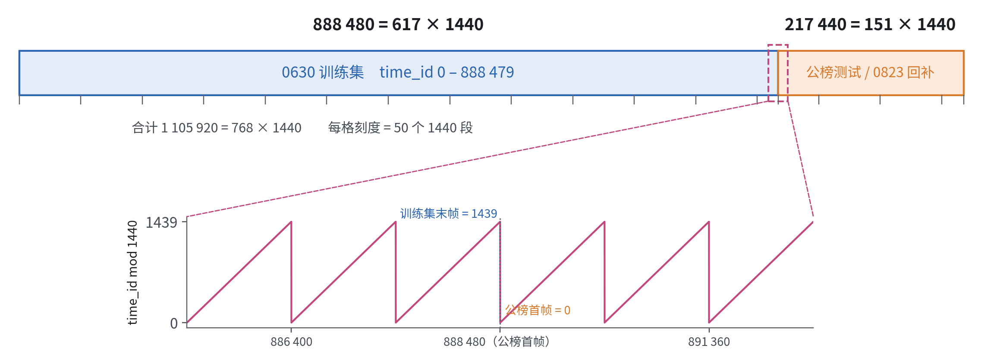
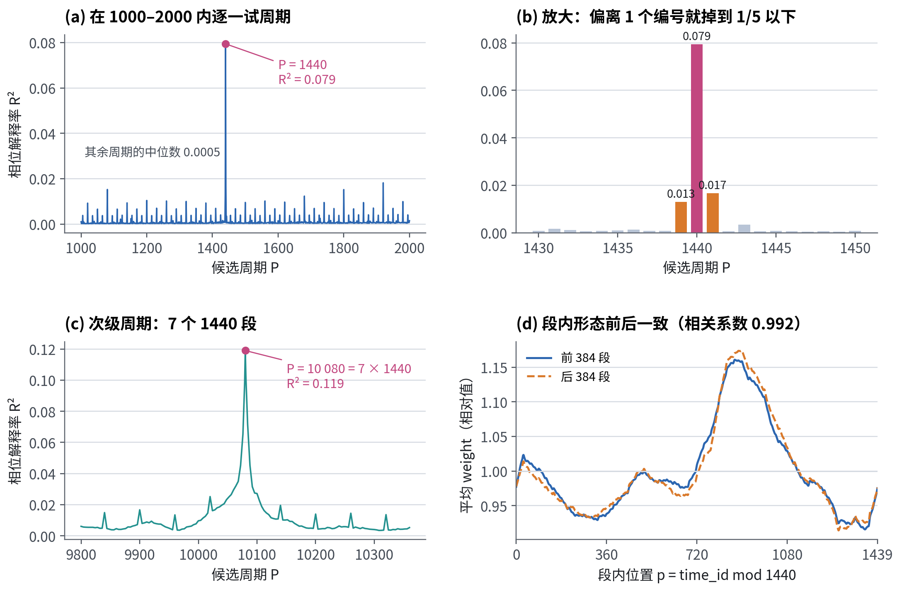
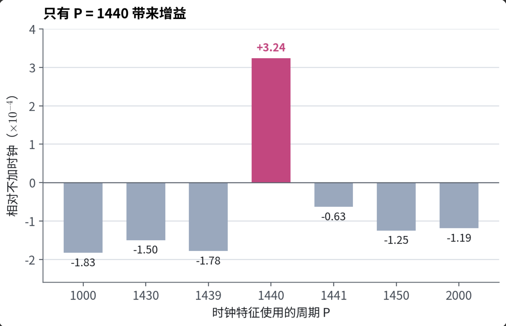
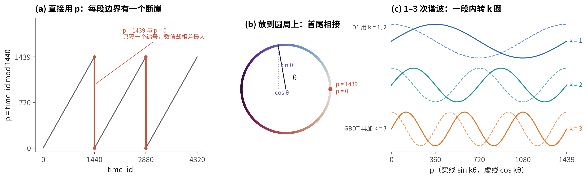
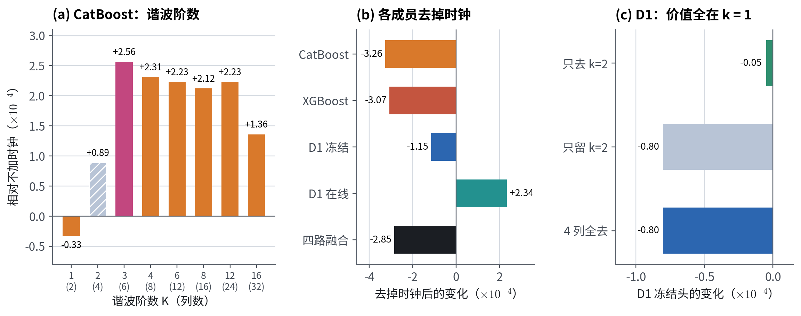

# time_id 相关：周期发现、用途与相位特征

> **摘要**　官方声明 `time_id` 是匿名索引，不带日历含义。我们发现它有一个精确的 1440 步周期，并用区间整除、周期扫描、换周期重训三条证据确认。策略在特征构建、训练取批、数据划分和在线学习四个环节以 1440 步为单位。直接进入模型的是时钟特征，即 `time_id mod 1440` 的圆周谐波编码：GBDT 用 6 列，D1 用 4 列。五折上全部去掉时钟特征，融合分数下降 2.85×10⁻⁴，5/5 折为负。

记 $p = \text{time\_id} \bmod 1440$，连续 1440 个 `time_id` 的一个周期称为"一段"。分数单位均为 $10^{-4}$（加权 R²）。

---

## 1　1440周期的发现（天的概念？）

### 证据 ①：编号区间恰好是 1440 的整数倍

| 数据                 | `time_id` 范围     |    长度 | ÷1440 |
| -------------------- | -------------------- | ------: | -----: |
| 0630 训练集          | 0 – 888 479         | 888 480 |    617 |
| 公榜测试 / 0823 回补 | 888 480 – 1 105 919 | 217 440 |    151 |

两段数据都能被 1440 整除，如果按照1440为1 day来理解，训练集617天，LB 151天，共计768天。

### 证据 ②：周期扫描在 1440 处出现孤立尖峰

对每个 `time_id` 取在场资产的平均 weight，得到一条序列（我的理解是该值可以粗略估计为当前time_id的市场的活跃度）。对每个候选周期 $P$，按 $t \bmod P$ 分组，计算组均值能解释的方差比例 $R^2(P)$。

| $P$   | 其余周期中位数 |  1439 |  **1440** |  1441 | **10 080 = 7×1440** |
| ------- | -------------: | ----: | --------------: | ----: | -------------------------: |
| $R^2$ |         0.0005 | 0.013 | **0.079** | 0.017 |            **0.119** |

- 1440 是 1000–2000 范围内唯一的显著峰；周期偏离 1 步，$R^2$ 就降到峰值的 1/5 以下。
- 另有 7×1440 的次级周期。
- d图展示数据在一个周期内存在稳定的数据形态（有忙时，闲时）由此启发使用相位来构建时钟特征，同时注意到：这条曲线有一个主峰和几个小起伏，不是简单的"一峰一谷"。这也解释了为什么时钟特征需要高次谐波：只用一次谐波（一段内一个波）拟合不出这种形状。数据前一半与后一半的段内剖面相关系数为 0.99，说明形态长期稳定。

### 证据 ③：不同周期数值重训对照实验

将周期作为超参，重训后在本地cv上评分

- 只有1440是有效的，其余都是有害的，可见1440是真实有效的模式。

**结论**：1440 步是一个周期是数据中真实存在的模式。模型实质性依赖这个周期。至于一段是否对应自然日，公开信息无法证实。

---

## 2　周期在策略中的用途

| 环节     | 做法                                                              |
| -------- | ----------------------------------------------------------------- |
| 特征构建 | 由$p$ 生成时钟特征（见第 3 节）                                 |
| 训练取批 | D1 训练时每step取一整个周期作为一个 batch                         |
| 数据划分 | 以周期为单位自然进行数据划分，由此构建本地cv划分                  |
| 在线学习 | 每段最后一帧（$p=1439$）触发 D1 的在线更新，更新窗口为最近 7 段 |

---

## 3　时钟特征

### 3.1　构造

$$
\theta = \frac{2\pi p}{1440},\qquad \text{clock}_K = [\sin\theta, \cos\theta, \ldots, \sin K\theta, \cos K\theta]
$$

- **圆周编码**：$p=1439$ 与 $p=0$ 相邻，但直接用 $p$ 的话两者数值相差最大。映射到圆上后首尾相接。
- **高次谐波**：一次谐波只能表达一段内一峰一谷，加入 $k=2,3$ 才能拟合更复杂的段内形态。

| 模型                          | 阶数$K$ | 列数 |
| ----------------------------- | --------: | ---: |
| GBDT模型族：CatBoost、XGBoost |         3 |    6 |
| MLP模型族：D1                 |         2 |    4 |

### 3.2　消融实验

**谐波阶数实验**

- **CatBoost**：$K=1/2/3$ 的本地cv增益分别为 −0.33 / +0.89 / **+2.56**；$K=4$ 到 12 是平台，$K=16$ 回落。选 $K=3$。
- **D1**：只去掉 2 次谐波，变化为 −0.05；4 列全去，变化为 −0.80。D1 的价值全部在一次谐波。

**去掉时钟特征**

| CatBoost | XGBoost | D1 冻结 | D1 在线 | **四路融合** |
| -------: | ------: | ------: | ------: | -----------------: |
|   −3.26 |  −3.07 |  −1.15 |   +2.34 |   **−2.85** |

价值主要来自 GBDT。D1 在线头去掉时钟反而略好，D1 两路合计基本持平。

### 3.3　其他时间特征构造方式的尝试

| 尝试                                               | 结果                                   |
| -------------------------------------------------- | -------------------------------------- |
| 直接用$p$ 原值（或类似的线性编码）               | −0.05，无效                           |
| 7 段周期内位置（one-hot）                          | CatBoost −2.0；神经网络 +0.08，不显著 |
| 时点常数列（同一时刻所有资产取同一值，如截面均值） | −4.1 至 −6.3，模型会拿它记忆时段     |
| 段内路径特征（段首以来的偏离等）                   | −0.4 至 −1.4                         |

只有以圆周谐波形式提供的段内位置稳定有效。

---
