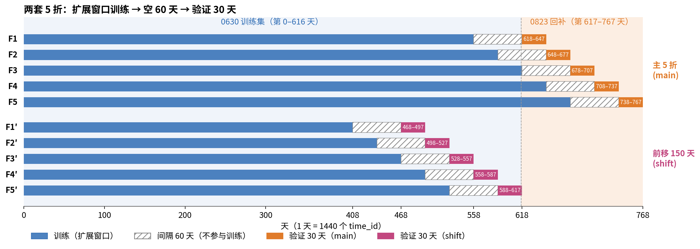
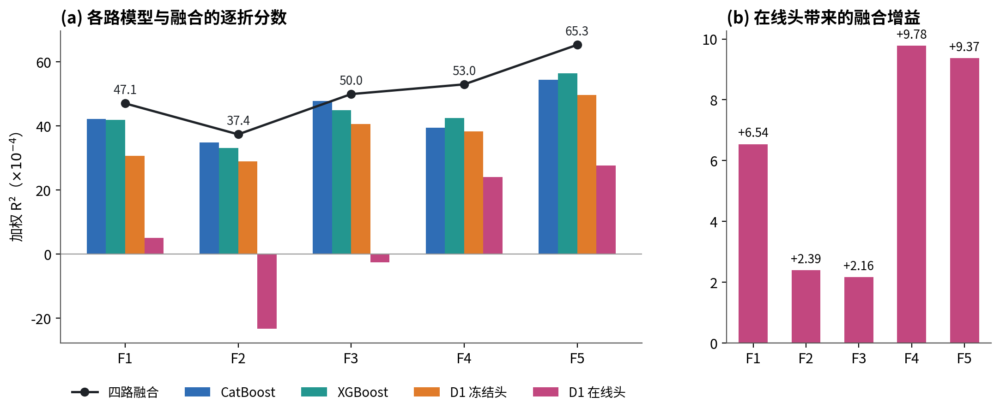
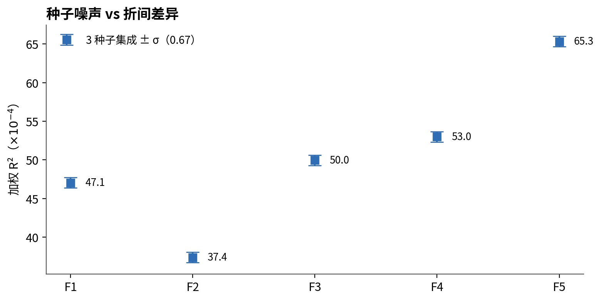

# 本地验证系统构建

> **摘要**　0823 标签回补后，我在第 618–767 天（共 150 天）上建了 5 个连续的 30 天验证折，30天用来模拟私榜长度。每折用扩展窗口训练，训练与验证之间空出 60 天，模拟比赛中从开发到私榜的两个月间隔。验证窗内按私榜方式逐帧推理。各折的分数水平和在线学习收益差异很大，调参判据定为：**5 折均值提升超过噪声底，且没有任何一折显著变差**。特征工程这类容易过拟合的模块，还要把 5 折整体前移 150 天复验一次。整套验证下，最终策略 5 折均值为 50.55，最差折为 37.39（F2）。

分数单位均为 $10^{-4}$（加权 R²）。假设 1 天 = 1440 个 `time_id`（见 time_id 报告）。

---

## 1　划分

我采用扩展窗口的 5 折划分，具体如下：

| 折 | 训练     | 间隔（不参与训练） | 验证                 |
| -- | -------- | ------------------ | -------------------- |
| F1 | 0 – 557 | 558 – 617         | **618 – 647** |
| F2 | 0 – 587 | 588 – 647         | **648 – 677** |
| F3 | 0 – 617 | 618 – 677         | **678 – 707** |
| F4 | 0 – 647 | 648 – 707         | **708 – 737** |
| F5 | 0 – 677 | 678 – 737         | **738 – 767** |

---

## 2　划分理由

### 理由1：时序任务：越近越像私榜

我的朴素理解是私榜紧接在回补数据之后。最后 150 天是离私榜最近的一段，市场状态和数据分布也最接近。但是事实可能并非如此，采用更好的5折划分，兼顾各个时间段（而不只是最后150 day）或许也是一个不错的选择。

### 理由2：尽可能的模拟私榜真实情况

我这里默认1440 time_id 为一天，私榜长度为 30 天,所以每折验证长度为 30×1440=43 200 个 time_id。为了模拟私榜的两个月间隔，训练与验证之间空出 60 天（86 400 个 time_id）。事实上，从私榜真实更新过程来看，这个假设存在需要怀疑的地方：周末私榜往往不更新，所以事实上周末两天是没有数据的？所以真实私榜的天数 < 30 day? 间隔也是同理。

---

## 3　本地cv用法：调参判据

### 3.1　各折所处的regime差异很大，判断有效改进应该看相对基线增益

|                    |              F1 |              F2 |              F3 |              F4 |              F5 |            均值 |
| ------------------ | --------------: | --------------: | --------------: | --------------: | --------------: | --------------: |
| CatBoost           |           42.17 |           34.88 |           47.80 |           39.50 |           54.44 |           43.76 |
| XGBoost            |           41.91 |           33.10 |           44.96 |           42.53 |           56.44 |           43.79 |
| D1 冻结头          |           30.62 |           28.97 |           40.64 |           38.37 |           49.66 |           37.65 |
| D1 在线头          |            5.05 |         −23.36 |          −2.54 |           24.05 |           27.72 |            6.19 |
| **四路融合** | **47.05** | **37.39** | **49.97** | **53.00** | **65.34** | **50.55** |
| 在线头的融合增益   |           +6.54 |           +2.39 |           +2.16 |           +9.78 |           +9.37 |           +6.05 |

- **水平差异**：四路融合最好折（F5，65.34）与最差折（F2，37.39）相差约 28，不同regime的绝对数值差异很大，难易差别很大。
- **在线收益差异**：在线头单独打分在 F2 为 −23.36、F5 为 +27.72，融合增益在 +2.2 到 +9.8 之间，F2/F3 不到 F4/F5 的四分之一。可见在线融合增益差异非常大。一个肉眼可见的模式是：越简单（体现为静态模型分数较高，经常是>40的分数）的regime，在线模型的分数较高，融合增益也更高。最明显的就是F4，F5两折，但是不幸的是，最终私榜的行为更像F2，所以我估计的在线学习增益应该是2e-4左右。

### 3.2　种子噪声底

| 3 种子集成                    | 单折 σ | 5 折均值 σ |
| ----------------------------- | ------: | ----------: |
| 单次结果（一份噪声）          |    0.67 |        0.30 |
| 改动 vs 基线的 Δ（两份噪声） |    0.95 |        0.43 |

### 3.3　我设定的判断方式

对一个改动，均需训练三种子，并作三种子集成，然后计算它在每折上相对基线的配对 Δ，判断标准大致为：

1. **均值**：5 折均值 Δ >均值噪声 σ（即 0.43约等于0.5），所以一个改动能带来均值约等于0.5e-4的增益，我会认为它是一个比较有效，可以信任的改进。
2. **稳健**：任何一折的 Δ 都不低于-1e-4，即不允许有显著变差的折。

### 3.4　前移复验：对于某些特别容易过拟合的模块实行，防止对验证集过拟合

5 折反复用于调参，本身也会被"调过头"。特征工程这类自由度大的模块尤其如此：试的组合多了，总能挑出一个碰巧在这 150 天上好的。

所以我的做法：把 5 折整体前移 150 天（验证区为第 468–617 天，图 1 下半部分），再训练、验证一遍。改动必须在两套折上都过判据才采纳。
